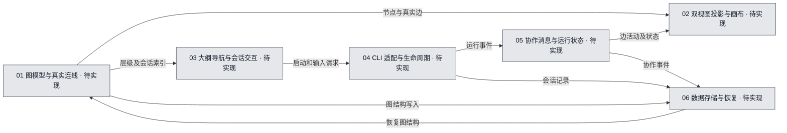

# 00 · 项目整体总览

## 当前进度与直接跳转

- 已完成：无。
- 正在完成：无。
- 待完成：[T-01 图模型与真实连线](#task-01)；[T-02 双视图投影与画布](#task-02)；[T-03 大纲导航与会话交互](#task-03)；[T-04 CLI 适配与生命周期](#task-04)；[T-05 协作消息与运行状态](#task-05)；[T-06 数据存储与恢复](#task-06)。

任务编号可直接跳到本文任务行，再进入具体文件文档的计划或继续位置。

## 1. 流程图可视化

- 图源：[00-整体总览.mmd](00-整体总览.mmd)。
- 图的用途：目标设计（`target`）；覆盖范围：全部六个核心系统及信息流，非用户当前创建的 Agent 工作流。
- 图例：灰色「待实现」表示应用功能尚无代码实现；随验收更新为黄色「进行中／部分实现／待验收」或绿色「已实现·已验收」。图中的颜色代表**开发实现进度**，不是运行时 Agent 明灭状态。

<!-- diagram-source: 00-整体总览.mmd -->

## 2. 系统说明

- **01 图模型与真实连线**：管理递归流程树、会话叶子节点和唯一可编辑的真实会话边。 对应入口见下方 T-01。
- **02 双视图投影与画布**：以同一份真实图数据提供全局展开与分层投影视图，按实际活动明灭连线。 对应入口见下方 T-02。
- **03 大纲导航与会话交互**：用树状大纲寻找会话，支持钻取子流程和管理单个 CLI 会话。 对应入口见下方 T-03。
- **04 CLI 适配与生命周期**：接入不同 Agent CLI，并可靠管理真实进程、输入输出、恢复和权限审批。 对应入口见下方 T-04。
- **05 协作消息与运行状态**：让有真实连线的会话安全交换消息，并记录投递与运行活动。 对应入口见下方 T-05。
- **06 数据存储与恢复**：保存图层级、真实会话边、配置和运行事件，让重启后仍可找回会话。 对应入口见下方 T-06。

## 3. 跨系统信息流

由图模型保存真实会话节点和连线，双视图系统基于同一份数据分别完整绘制与聚合投影；大纲导航和会话界面通过会话 ID 联系 CLI 运行时；运行时事件进入协作消息与状态汇总模块，最终更新节点与连线的明灭；存储负责图、会话和事件的恢复。

**关键产品约束**：只有会话节点与会话节点之间的连线可编辑。父流程图中的子流程聚合连线不是另一种真实连线，必须由真实会话连线动态计算。全局展开视图需要拆分显示全部真实连线，分层视图按当前层级合并展示。子流程节点可递归包含子流程，也可打开单会话页面。大纲与画布使用同一层级数据。

**图源用途提示**：本图是开发系统的目标架构图，不等同于应用中用户创建的运行时 Agent 画布；图中的实线只描述系统之间的数据流。

## 4. 需完成任务序列

| 任务编号 | 拆分后的任务目标 | 关联流程图节点／下层开发入口 | 文件文档继续入口 | 前置依赖／阻塞原因 | 验收标准 | 完成状态 |
| --- | --- | --- | --- | --- | --- | --- |
| T-01 | 从整体信息流理解图模型与真实连线模块与其他系统的输入输出，建立目标设计与文件开发入口。 | [整体图源](00-整体总览.mmd)（target），主节点 `N01`／01；[系统总文档任务](01-图模型与真实连线/01-图模型与真实连线总文档.md#task-01) | [主要文件计划](../文件开发文档/源码目录镜像/src/shared/domain/graph.ts.md#plan) [相关文件继续](../文件开发文档/源码目录镜像/src/main/graph/validateEdge.ts.md#continue) | 前置依赖：无。 阻塞：无。 | 管理递归流程树、会话叶子节点和唯一可编辑的真实会话边。 关键端到端情景满足所属系统全部有效任务验收；异常/权限边界可验证。 | 待开始 |
| T-02 | 从整体信息流理解双视图投影与画布模块与其他系统的输入输出，建立目标设计与文件开发入口。 | [整体图源](00-整体总览.mmd)（target），主节点 `N02`／02；[系统总文档任务](02-双视图投影与画布/02-双视图投影与画布总文档.md#task-01) | [主要文件计划](../文件开发文档/源码目录镜像/src/renderer/canvas/GlobalCanvas.tsx.md#plan) [相关文件继续](../文件开发文档/源码目录镜像/src/renderer/canvas/HierarchicalCanvas.tsx.md#continue) | 前置依赖：无。 阻塞：无。 | 以同一份真实图数据提供全局展开与分层投影视图，按实际活动明灭连线。 关键端到端情景满足所属系统全部有效任务验收；异常/权限边界可验证。 | 待开始 |
| T-03 | 从整体信息流理解大纲导航与会话交互模块与其他系统的输入输出，建立目标设计与文件开发入口。 | [整体图源](00-整体总览.mmd)（target），主节点 `N03`／03；[系统总文档任务](03-大纲导航与会话交互/03-大纲导航与会话交互总文档.md#task-01) | [主要文件计划](../文件开发文档/源码目录镜像/src/renderer/navigation/OutlineTree.tsx.md#plan) [相关文件继续](../文件开发文档/源码目录镜像/src/main/agents/SessionManager.ts.md#continue) | 前置依赖：无。 阻塞：无。 | 用树状大纲寻找会话，支持钻取子流程和管理单个 CLI 会话。 关键端到端情景满足所属系统全部有效任务验收；异常/权限边界可验证。 | 待开始 |
| T-04 | 从整体信息流理解CLI 适配与生命周期模块与其他系统的输入输出，建立目标设计与文件开发入口。 | [整体图源](00-整体总览.mmd)（target），主节点 `N04`／04；[系统总文档任务](04-CLI 适配与生命周期/04-CLI 适配与生命周期总文档.md#task-01) | [主要文件计划](../文件开发文档/源码目录镜像/src/main/agents/AgentAdapter.ts.md#plan) [相关文件继续](../文件开发文档/源码目录镜像/src/main/persistence/Recovery.ts.md#continue) | 前置依赖：本系统对应的必要领域契约经确认。 阻塞：无；CLI 适配细节待执行阶段验证。 | 接入不同 Agent CLI，并可靠管理真实进程、输入输出、恢复和权限审批。 关键端到端情景满足所属系统全部有效任务验收；异常/权限边界可验证。 | 待开始 |
| T-05 | 从整体信息流理解协作消息与运行状态模块与其他系统的输入输出，建立目标设计与文件开发入口。 | [整体图源](00-整体总览.mmd)（target），主节点 `N05`／05；[系统总文档任务](05-协作消息与运行状态/05-协作消息与运行状态总文档.md#task-01) | [主要文件计划](../文件开发文档/源码目录镜像/src/main/collaboration/MessageRouter.ts.md#plan) [相关文件继续](../文件开发文档/源码目录镜像/src/shared/domain/events.ts.md#continue) | 前置依赖：本系统对应的必要领域契约经确认。 阻塞：无；CLI 适配细节待执行阶段验证。 | 让有真实连线的会话安全交换消息，并记录投递与运行活动。 关键端到端情景满足所属系统全部有效任务验收；异常/权限边界可验证。 | 待开始 |
| T-06 | 从整体信息流理解数据存储与恢复模块与其他系统的输入输出，建立目标设计与文件开发入口。 | [整体图源](00-整体总览.mmd)（target），主节点 `N06`／06；[系统总文档任务](06-数据存储与恢复/06-数据存储与恢复总文档.md#task-01) | [主要文件计划](../文件开发文档/源码目录镜像/src/main/persistence/Database.ts.md#plan) [相关文件继续](../文件开发文档/源码目录镜像/src/main/agents/SessionManager.ts.md#continue) | 前置依赖：无。 阻塞：无。 | 保存图层级、真实会话边、配置和运行事件，让重启后仍可找回会话。 关键端到端情景满足所属系统全部有效任务验收；异常/权限边界可验证。 | 待开始 |

## 5. 已执行但已废弃的任务序列

暂无已执行后废弃的任务。

| 任务编号 | 拆分后的任务目标 | 关联流程图节点／下层开发入口 | 文件文档继续入口 | 前置依赖／阻塞原因 | 验收标准 | 完成状态 |
| --- | --- | --- | --- | --- | --- | --- |
