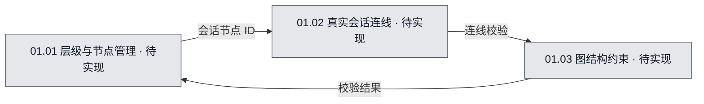

# 01 · 图模型与真实连线

## 当前进度与直接跳转

- 已完成：无。
- 正在完成：无。
- 待完成：[T-01 层级与节点管理](#task-01)；[T-02 真实会话连线](#task-02)；[T-03 图结构约束](#task-03)。

任务编号可直接跳到本文任务行，再进入具体文件文档的计划或继续位置。

## 1. 系统职责

管理递归流程树、会话叶子节点和唯一可编辑的真实会话边。

## 2. 流程图可视化

- 图源：[01-图模型与真实连线.mmd](01-图模型与真实连线.mmd)。
- 图的用途：目标设计（`target`）；覆盖范围：图模型与真实连线的内部职责与信息流。
- 图例：灰色「待实现」表示应用功能尚无代码实现；随验收更新为黄色「进行中／部分实现／待验收」或绿色「已实现·已验收」。图中的颜色代表**开发实现进度**，不是运行时 Agent 明灭状态。

<!-- diagram-source: 01-图模型与真实连线.mmd -->

## 3. 节点职责

- **01.01 层级与节点管理**：维护根流程、子流程、会话节点的层级关系；支持任意深度递归。。开发入口见任务 T-01。
- **01.02 真实会话连线**：创建、删除和查询会话到会话的真实边；绝不创建流程到流程的边。。开发入口见任务 T-02。
- **01.03 图结构约束**：对节点类型、层级包含关系和边端点施加一致性约束。。开发入口见任务 T-03。

## 4. 与其他系统的交接

输入：UI 的建图、移动、连线请求；输出：稳定层级与真实边集合，供投影、导航和存储使用。 相关关系见[00 整体总览](../00-整体总览.md)；具体开发入口见下方任务行。

## 5. 当前开发或改造方案

项目内存在一个根流程；流程节点可嵌套子流程，叶节点绑定 Agent 会话。用户只能在两个叶子会话节点间建立真实连线，任何流程图节点不得作为真实边端点；编辑与存储层均需校验。编号是开发文档的稳定标识，不等于运行时图节点的 ID。

本系统属于从零开发的**目标设计**，暂无已完成产品功能。技术选型均为建议或待验证方案，真实实现与验收进度应从文件开发文档更新。

## 6. 需完成任务序列

| 任务编号 | 拆分后的任务目标 | 关联流程图节点／下层开发入口 | 文件文档继续入口 | 前置依赖／阻塞原因 | 验收标准 | 完成状态 |
| --- | --- | --- | --- | --- | --- | --- |
| T-01 | 维护根流程、子流程、会话节点的层级关系；支持任意深度递归。 | [系统图源](01-图模型与真实连线.mmd)（target），节点 `N01_01`／01.01；[节点开发入口](01.01-层级与节点管理.md#task-01) | [graph.ts 计划](../../文件开发文档/源码目录镜像/src/shared/domain/graph.ts.md#plan) [GraphStore.ts 计划](../../文件开发文档/源码目录镜像/src/main/graph/GraphStore.ts.md#plan) | 前置依赖：无。 阻塞：无。 | 输入：创建子流程或会话节点，移动到其他父流程，保证无包含环；节点 ID 稳定。；预期：层级编辑操作、当前图结构。；无效输入应拒绝且不破坏已保存图。 | 待开始 |
| T-02 | 实现会话节点之间的真实连线增删查，禁止流程节点成为真实边端点。 | [系统图源](01-图模型与真实连线.mmd)（target），节点 `N01_02`／01.02；[节点开发入口](01.02-真实会话连线/01.02-真实会话连线总文档.md#task-01) | [edges.ts 计划](../../文件开发文档/源码目录镜像/src/shared/domain/edges.ts.md#plan) [validateEdge.ts 计划](../../文件开发文档/源码目录镜像/src/main/graph/validateEdge.ts.md#plan) | 前置依赖：无。 阻塞：无。 | 两个会话节点可建立可持久化真实边；尝试连接任何子流程节点均被拒绝；删除真实边后父层聚合投影同步消失。 | 待开始 |
| T-03 | 对节点类型、层级包含关系和边端点施加一致性约束。 | [系统图源](01-图模型与真实连线.mmd)（target），节点 `N01_03`／01.03；[节点开发入口](01.03-图结构约束.md#task-01) | [GraphStore.ts 计划](../../文件开发文档/源码目录镜像/src/main/graph/GraphStore.ts.md#plan) [validateEdge.ts 计划](../../文件开发文档/源码目录镜像/src/main/graph/validateEdge.ts.md#plan) | 前置依赖：无。 阻塞：无。 | 输入：校验循环包含、悬空引用、流程节点误连线；后端写入时重复检查。；预期：图编辑指令；验证结果及错误原因。；无效输入应拒绝且不破坏已保存图。 | 待开始 |

## 7. 已执行但已废弃的任务序列

暂无已执行后废弃的任务。

| 任务编号 | 拆分后的任务目标 | 关联流程图节点／下层开发入口 | 文件文档继续入口 | 前置依赖／阻塞原因 | 验收标准 | 完成状态 |
| --- | --- | --- | --- | --- | --- | --- |
