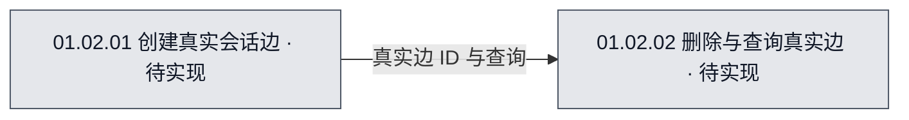

# 01.02 · 真实会话连线

## 当前进度与直接跳转

- 已完成：无。
- 正在完成：无。
- 待完成：[T-01 创建真实会话边](#task-01)；[T-02 删除与查询真实边](#task-02)。

任务编号可直接跳到本文任务行，再进入具体文件文档的计划或继续位置。

## 1. 节点位置与职责

本节点在[01 图模型与真实连线系统图](../01-图模型与真实连线.mmd)中定义，ID `N01_02`、编号 `01.02`。它进一步展开为两个可独立验收的子节点；仍表示同一个功能节点，不创建新的流程图到流程图的真实连接类型。

## 2. 流程图可视化

- 图源：[01.02-真实会话连线.mmd](01.02-真实会话连线.mmd)。
- 图的用途：目标设计（`target`）；覆盖范围：真实会话边的创建、删除与查询。
- 图例：灰色「待实现」表示应用功能尚无代码实现；随验收更新为黄色「进行中／部分实现／待验收」或绿色「已实现·已验收」。图中的颜色代表**开发实现进度**，不是运行时 Agent 明灭状态。

<!-- diagram-source: 01.02-真实会话连线.mmd -->

## 3. 输入与输出

输入为会话节点 ID 与具体真实边的操作请求；输出为真实边 ID、查询结果或错误。连接约束对所有视图一致，分层视图中的聚合连线仅用于展示。

## 4. 当前工作方式与开发方案

当前为目标设计，暂无代码。先完成会话端点校验和实际边数据模型，再实现查询、删除、事件通知；图形投影在系统 02 根据真实边派生，不在此处保存聚合边。

## 5. 对应文件与具体修改

| 文件开发文档 | 文件承担的职责 | 准备修改什么 |
| --- | --- | --- |
| [连线类型](../../../文件开发文档/源码目录镜像/src/shared/domain/edges.ts.md#plan) | 真实边领域契约 | 限定端点为会话 ID，区分只读投影边 |
| [边校验](../../../文件开发文档/源码目录镜像/src/main/graph/validateEdge.ts.md#plan) | 连接的写入约束 | 阻止子流程节点参与真实边 |
| [图存储](../../../文件开发文档/源码目录镜像/src/main/graph/GraphStore.ts.md#plan) | 边的查询与删除 | 按 edgeId 管理真实边 |

## 6. 需完成任务序列

| 任务编号 | 拆分后的任务目标 | 关联流程图节点／下层开发入口 | 文件文档继续入口 | 前置依赖／阻塞原因 | 验收标准 | 完成状态 |
| --- | --- | --- | --- | --- | --- | --- |
| T-01 | 从两个实际会话节点建立连线，校验端点类型后原子化保存。 | [局部图源](01.02-真实会话连线.mmd)（target），`N01_02_01`／01.02.01；[节点任务](01.02.01-创建真实会话边.md#task-01) | [validateEdge.ts 计划](../../../文件开发文档/源码目录镜像/src/main/graph/validateEdge.ts.md#plan) [edges.ts 计划](../../../文件开发文档/源码目录镜像/src/shared/domain/edges.ts.md#plan) | 前置依赖：无。 阻塞：无。 | 输入：创建边请求；输出：真实 edgeId 或错误；非法流程节点连线不能落库。 | 待开始 |
| T-02 | 按真实 edgeId 查询、删除、枚举会话的邻接关系，不受视图折叠影响。 | [局部图源](01.02-真实会话连线.mmd)（target），`N01_02_02`／01.02.02；[节点任务](01.02.02-删除与查询真实边.md#task-01) | [GraphStore.ts 计划](../../../文件开发文档/源码目录镜像/src/main/graph/GraphStore.ts.md#plan) [edges.ts 计划](../../../文件开发文档/源码目录镜像/src/shared/domain/edges.ts.md#plan) | 前置依赖：无。 阻塞：无。 | 输入：edgeId 或 sessionNodeId；输出：边列表及删除结果；非法流程节点连线不能落库。 | 待开始 |

## 7. 已执行但已废弃的任务序列

暂无已执行后废弃的任务。

| 任务编号 | 拆分后的任务目标 | 关联流程图节点／下层开发入口 | 文件文档继续入口 | 前置依赖／阻塞原因 | 验收标准 | 完成状态 |
| --- | --- | --- | --- | --- | --- | --- |
