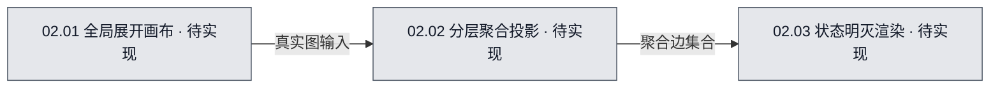

# 02 · 双视图投影与画布

## 当前进度与直接跳转

- 已完成：无。
- 正在完成：无。
- 待完成：[T-01 全局展开画布](#task-01)；[T-02 分层聚合投影](#task-02)；[T-03 状态明灭渲染](#task-03)。

任务编号可直接跳到本文任务行，再进入具体文件文档的计划或继续位置。

## 1. 系统职责

以同一份真实图数据提供全局展开与分层投影视图，按实际活动明灭连线。

## 2. 流程图可视化

- 图源：[02-双视图投影与画布.mmd](02-双视图投影与画布.mmd)。
- 图的用途：目标设计（`target`）；覆盖范围：双视图投影与画布的内部职责与信息流。
- 图例：灰色「待实现」表示应用功能尚无代码实现；随验收更新为黄色「进行中／部分实现／待验收」或绿色「已实现·已验收」。图中的颜色代表**开发实现进度**，不是运行时 Agent 明灭状态。

<!-- diagram-source: 02-双视图投影与画布.mmd -->

## 3. 节点职责

- **02.01 全局展开画布**：将整个层级结构展开到无边界画布，逐条显示真实会话连线。。开发入口见任务 T-01。
- **02.02 分层聚合投影**：根据当前查看流程将多条底层真实边聚合成只读父层连线。。开发入口见任务 T-02。
- **02.03 状态明灭渲染**：用节点与连线的明暗、图标和数量展示运行状态。。开发入口见任务 T-03。

## 4. 与其他系统的交接

输入：流程树、真实会话边和运行状态；输出：全局图、分层聚合图及交互事件。 相关关系见[00 整体总览](../00-整体总览.md)；具体开发入口见下方任务行。

## 5. 当前开发或改造方案

全局视图画所有会话节点和全部真实边，子流程以边界容器表达。分层视图每次只画当前流程的直接子节点；外部会话之间的真实边投影至相应子流程节点，按可见端点与方向聚合，内部边隐藏。聚合边只有只读展示属性，不能直接新建或删除；全局视图可在会话叶节点建立真实边。

本系统属于从零开发的**目标设计**，暂无已完成产品功能。技术选型均为建议或待验证方案，真实实现与验收进度应从文件开发文档更新。

## 6. 需完成任务序列

| 任务编号 | 拆分后的任务目标 | 关联流程图节点／下层开发入口 | 文件文档继续入口 | 前置依赖／阻塞原因 | 验收标准 | 完成状态 |
| --- | --- | --- | --- | --- | --- | --- |
| T-01 | 将整个层级结构展开到无边界画布，逐条显示真实会话连线。 | [系统图源](02-双视图投影与画布.mmd)（target），节点 `N02_01`／02.01；[节点开发入口](02.01-全局展开画布.md#task-01) | [GlobalCanvas.tsx 计划](../../文件开发文档/源码目录镜像/src/renderer/canvas/GlobalCanvas.tsx.md#plan) [edges.ts 计划](../../文件开发文档/源码目录镜像/src/shared/domain/edges.ts.md#plan) | 前置依赖：无。 阻塞：无。 | 输入：递归绘制子流程容器与会话节点，使用真实边数据生成可编辑连接。；预期：层级树、会话节点及真实边；输出完整画布和节点点击事件。；无效输入应拒绝且不破坏已保存图。 | 待开始 |
| T-02 | 根据当前查看流程将多条底层真实边聚合成只读父层连线。 | [系统图源](02-双视图投影与画布.mmd)（target），节点 `N02_02`／02.02；[节点开发入口](02.02-分层聚合投影.md#task-01) | [projectGraph.ts 计划](../../文件开发文档/源码目录镜像/src/shared/graph/projectGraph.ts.md#plan) [HierarchicalCanvas.tsx 计划](../../文件开发文档/源码目录镜像/src/renderer/canvas/HierarchicalCanvas.tsx.md#plan) | 前置依赖：无。 阻塞：无。 | 输入：对真实边两端分别求当前层的可见直接子节点，映射成不同节点则按有向端点聚合；保留底层边 ID。；预期：当前 flowId 与真实边全集；输出当前层节点与 ProjectedEdge。；无效输入应拒绝且不破坏已保存图。 | 待开始 |
| T-03 | 用节点与连线的明暗、图标和数量展示运行状态。 | [系统图源](02-双视图投影与画布.mmd)（target），节点 `N02_03`／02.03；[节点开发入口](02.03-状态明灭渲染.md#task-01) | [EdgeStatusLayer.tsx 计划](../../文件开发文档/源码目录镜像/src/renderer/canvas/EdgeStatusLayer.tsx.md#plan) [aggregateStatus.ts 计划](../../文件开发文档/源码目录镜像/src/main/status/aggregateStatus.ts.md#plan) | 前置依赖：无。 阻塞：无。 | 输入：会话节点显示实时状态；子流程聚合子会话状态；聚合连线展示底层真实边的活动比例及异常数量。；预期：会话/连线事件流；输出带文字标记的状态展示。；无效输入应拒绝且不破坏已保存图。 | 待开始 |

## 7. 已执行但已废弃的任务序列

暂无已执行后废弃的任务。

| 任务编号 | 拆分后的任务目标 | 关联流程图节点／下层开发入口 | 文件文档继续入口 | 前置依赖／阻塞原因 | 验收标准 | 完成状态 |
| --- | --- | --- | --- | --- | --- | --- |
