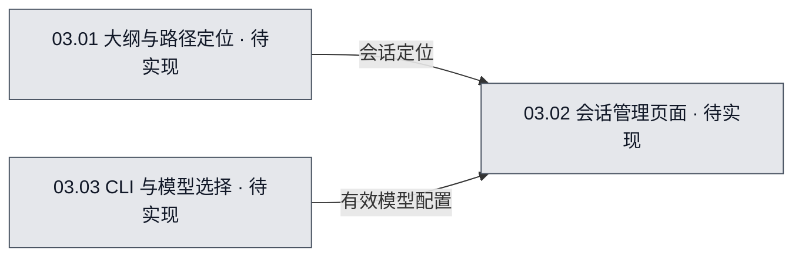

# 03 · 大纲导航与会话交互

## 当前进度与直接跳转

- 已完成：无。
- 正在完成：无。
- 待完成：[T-01 大纲与路径定位](#task-01)；[T-02 会话管理页面](#task-02)；[T-03 CLI 与模型选择](#task-03)。

任务编号可直接跳到本文任务行，再进入具体文件文档的计划或继续位置。

## 1. 系统职责

用树状大纲寻找会话，支持钻取子流程和管理单个 CLI 会话。

## 2. 流程图可视化

- 图源：[03-大纲导航与会话交互.mmd](03-大纲导航与会话交互.mmd)。
- 图的用途：目标设计（`target`）；覆盖范围：大纲导航与会话交互的内部职责与信息流。
- 图例：灰色「待实现」表示应用功能尚无代码实现；随验收更新为黄色「进行中／部分实现／待验收」或绿色「已实现·已验收」。图中的颜色代表**开发实现进度**，不是运行时 Agent 明灭状态。

<!-- diagram-source: 03-大纲导航与会话交互.mmd -->

## 3. 节点职责

- **03.01 大纲与路径定位**：按照父子流程层级搜索、展开并导航到任意会话。。开发入口见任务 T-01。
- **03.02 会话管理页面**：为每个会话提供聊天/终端、状态与审批的集中入口。。开发入口见任务 T-02。
- **03.03 CLI 与模型选择**：创建会话节点时选择 CLI 和其支持的模型配置。。开发入口见任务 T-03。

## 4. 与其他系统的交接

输入：树、会话 ID、CLI 能力；输出：导航定位、创建会话与用户交互命令。 相关关系见[00 整体总览](../00-整体总览.md)；具体开发入口见下方任务行。

## 5. 当前开发或改造方案

大纲目录与画布共享同一个流程树，不复制会话对象。进入子流程会更新面包屑；进入叶子节点显示完整会话管理界面。创建会话时先选择 Agent CLI 与模型，但是否允许运行中更换模型取决于适配器能力。

本系统属于从零开发的**目标设计**，暂无已完成产品功能。技术选型均为建议或待验证方案，真实实现与验收进度应从文件开发文档更新。

## 6. 需完成任务序列

| 任务编号 | 拆分后的任务目标 | 关联流程图节点／下层开发入口 | 文件文档继续入口 | 前置依赖／阻塞原因 | 验收标准 | 完成状态 |
| --- | --- | --- | --- | --- | --- | --- |
| T-01 | 按照父子流程层级搜索、展开并导航到任意会话。 | [系统图源](03-大纲导航与会话交互.mmd)（target），节点 `N03_01`／03.01；[节点开发入口](03.01-大纲与路径定位.md#task-01) | [OutlineTree.tsx 计划](../../文件开发文档/源码目录镜像/src/renderer/navigation/OutlineTree.tsx.md#plan) [graph.ts 计划](../../文件开发文档/源码目录镜像/src/shared/domain/graph.ts.md#plan) | 前置依赖：无。 阻塞：无。 | 输入：树状目录以节点 ID 为主键，允许定位、聚焦、打开祖先流程。；预期：用户选中的节点 ID；导航路径、定位请求。；无效输入应拒绝且不破坏已保存图。 | 待开始 |
| T-02 | 为每个会话提供聊天/终端、状态与审批的集中入口。 | [系统图源](03-大纲导航与会话交互.mmd)（target），节点 `N03_02`／03.02；[节点开发入口](03.02-会话管理页面.md#task-01) | [SessionView.tsx 计划](../../文件开发文档/源码目录镜像/src/renderer/sessions/SessionView.tsx.md#plan) [SessionManager.ts 计划](../../文件开发文档/源码目录镜像/src/main/agents/SessionManager.ts.md#plan) | 前置依赖：无。 阻塞：无。 | 输入：按 sessionId 持续订阅输出；不因切换图层或关闭面板终止进程。；预期：会话事件与用户输入；输出 CLI 指令、任务状态和审批操作。；无效输入应拒绝且不破坏已保存图。 | 待开始 |
| T-03 | 创建会话节点时选择 CLI 和其支持的模型配置。 | [系统图源](03-大纲导航与会话交互.mmd)（target），节点 `N03_03`／03.03；[节点开发入口](03.03-CLI 与模型选择.md#task-01) | [ModelPicker.tsx 计划](../../文件开发文档/源码目录镜像/src/renderer/sessions/ModelPicker.tsx.md#plan) [AgentAdapter.ts 计划](../../文件开发文档/源码目录镜像/src/main/agents/AgentAdapter.ts.md#plan) | 前置依赖：无。 阻塞：无。 | 输入：读取适配器能力并进行校验；模型不可用时提示，不默认伪造成功切换。；预期：用户选择的 CLI/模型/工作目录；输出有效会话创建配置。；无效输入应拒绝且不破坏已保存图。 | 待开始 |

## 7. 已执行但已废弃的任务序列

暂无已执行后废弃的任务。

| 任务编号 | 拆分后的任务目标 | 关联流程图节点／下层开发入口 | 文件文档继续入口 | 前置依赖／阻塞原因 | 验收标准 | 完成状态 |
| --- | --- | --- | --- | --- | --- | --- |
