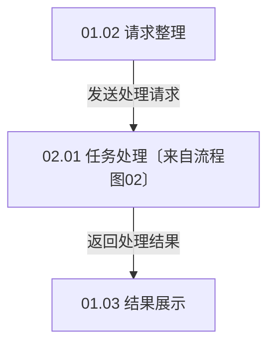
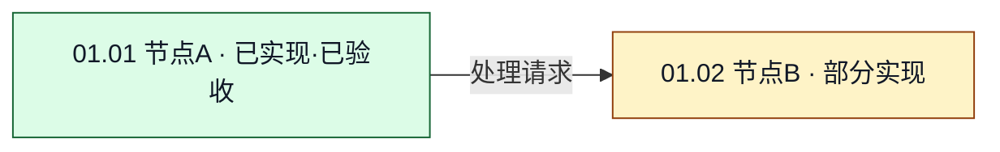

# 开发文档仓库：目录结构与文档编写规范

本文只整理用户已经提出的仓库设计，不加入尚未讨论的扩展要求。适用于人与 Agent 协作开发的新项目，以及已有项目的改进。

## 一、总文件夹需要建立什么

```text
项目开发文档仓库/
├── 项目开发总文档.md
├── 流程图/
│   ├── 00-整体总览.md
│   ├── 00-整体总览.mmd
│   ├── 01-系统A/
│   │   ├── 01-系统A总文档.md
│   │   ├── 01-系统A.mmd
│   │   ├── 01.01-节点A.md
│   │   └── 01.02-节点B/
│   │       ├── 01.02-节点B总文档.md
│   │       ├── 01.02-节点B.mmd
│   │       ├── 输入与输出.md
│   │       └── 内部处理.md
│   └── 02-系统B/
│       ├── 02-系统B总文档.md
│       ├── 02-系统B.mmd
│       └── 02.01-节点C.md
├── 文件开发文档/
│   └── 源码目录镜像/
│       └── src/
│           ├── main.rs.md
│           └── service/
│               └── handler.rs.md
└── 改进需求/                         # 改进已有项目时增加
    ├── 改进需求.md
    ├── 改进实现总览.md
    └── 分项开发总览/
        ├── 需求A开发总览.md
        └── 需求B开发总览.md
```

上述系统、节点、源码目录和文件名只是示例，应替换为实际项目内容。

三类基础入口承担不同职责：

- **项目开发总文档**：从项目整体进入。
- **流程图文档**：从功能、系统、流程和信息流进入，同时承载功能需求与开发方案。
- **文件开发文档**：按真实源码目录组织各文件文档，通过目录层级定位，或从任务表直接进入具体文件章节；不建立独立索引文件。

从零开始开发时，功能需求、整体方案、局部设计和任务安排统一写在“流程图”下的开发文档中，不另建重复的功能开发文档目录。功能需要多个节点配合时，在所属系统总文档中说明使用过程及节点协作，链接各节点文档。

改进已有项目时，再增加**改进需求入口**，把当前改进目标、各项方案和整体实现图景联系起来。

## 二、总文件夹下的《项目开发总文档.md》怎么写

这份文档是整个仓库的入口。读者不必先看具体代码文件，就能知道项目是什么，以及从哪里继续阅读。

建议按以下结构编写：

```markdown
# 项目开发总文档

## 当前进度与直接跳转
已完成：链接本文下方已验收任务；正在完成：链接本文下方当前任务。
读者可以直接跳到对应任务，再通过文件开发文档的继续入口接着开发。
具体格式见本规范第五节；没有对应任务时写“无”。

## 1. 项目是什么
写清项目的用途、主要功能及整体工作方式。

## 2. 整体系统划分
列出有哪些系统、各系统负责什么。具体开发入口放在下方任务序列中。

## 3. 需完成任务序列
按第五节格式列出拆分后的目标、关联流程图及节点、下层开发文档与任务、
文件文档继续入口、任务依赖与阻塞原因、验收标准和完成状态。
总文档的任务可以覆盖系统或完整能力，相关系统、功能和改进方案的入口都放在对应任务中。
文件继续入口仍需明确，不另设一份按查看方式分类的导航板块。

| 任务编号 | 拆分后的任务目标 | 关联流程图节点／下层开发入口 | 文件文档继续入口 | 前置依赖／阻塞原因 | 验收标准 | 完成状态 |
| --- | --- | --- | --- | --- | --- | --- |
| <a id="task-01"></a>T-01 | 填写可独立验收的整体能力目标 | 填写图源、视图、节点及系统或改进方案的任务链接 | 填写具体文件文档的章节链接 | 前置依赖：无或明确任务链接。<br>阻塞：无或原因及解除条件。 | 填写整体验收条件与预期结果 | 待开始 |

## 4. 已执行但已废弃的任务序列

暂无已执行后废弃的任务。有记录时按 5.5 填入下表，不虚构占位任务。

| 任务编号 | 拆分后的任务目标 | 关联流程图节点／下层开发入口 | 文件文档继续入口 | 前置依赖／阻塞原因 | 验收标准 | 完成状态 |
| --- | --- | --- | --- | --- | --- | --- |
```

总文档负责给出整体认识，通过拆分好的任务序列链接具体开发文档。具体文件的方法实现与修改记录放在文件开发文档中，不在总文档里复制一遍。

## 三、“流程图”文件夹下放什么，文档怎么写

### 3.1 《00-整体总览.md》：先看多系统整体

这份文档展示 `00-整体总览.mmd` 中整个项目的主要系统及系统间的信息流动。先说明整体，再由任务序列链接各主节点对应的系统开发文档和局部图。

```markdown
# 00 · 项目整体总览

## 当前进度与直接跳转
已完成：链接本文任务；正在完成：链接本文任务；没有则写“无”。
可直接跳到下方任务，再进入文件文档继续。格式见第五节。

## 1. 整体流程图
标注图源、图的用途（当前实现／目标设计）及覆盖范围。
使用 Obsidian 内置支持的 mermaid 代码块展示 .mmd 图源，具体写法见 3.8。
图中画出主要系统及传递的信息，用图例、颜色和文字标明实现状态。

## 2. 系统说明
说明 .mmd 中各主节点的编号、系统名称和主要职责。
对应系统总文档的入口放入下方相关任务。

## 3. 跨系统信息流
说明从哪里到哪里、传递什么信息，以及由谁继续处理。

## 4. 需完成任务序列
列出整体能力的拆分目标、关联图源和节点、系统开发文档与下层任务、文件文档继续入口、
依赖与阻塞原因、验收标准和完成状态，不在这里复制文件实现细节。

| 任务编号 | 拆分后的任务目标 | 关联流程图节点／下层开发入口 | 文件文档继续入口 | 前置依赖／阻塞原因 | 验收标准 | 完成状态 |
| --- | --- | --- | --- | --- | --- | --- |
| <a id="task-01"></a>T-01 | 填写整体能力目标 | 填写图源、视图、系统主节点及系统任务链接 | 填写具体文件文档的章节链接 | 前置依赖：无或明确任务链接。<br>阻塞：无或原因及解除条件。 | 填写跨系统协作的验收条件与预期结果 | 待开始 |

## 5. 已执行但已废弃的任务序列

暂无已执行后废弃的任务。有记录时按 5.5 填入下表，不虚构占位任务。

| 任务编号 | 拆分后的任务目标 | 关联流程图节点／下层开发入口 | 文件文档继续入口 | 前置依赖／阻塞原因 | 验收标准 | 完成状态 |
| --- | --- | --- | --- | --- | --- | --- |
```

整体图不需要塞入每个函数和所有细节。细节由系统图和节点图展开。

### 3.2 系统文件夹：放该系统的总文档和节点文档

每个系统建立一个文件夹。例如 `01-系统A/` 中放：

- `01-系统A总文档.md`：该系统的局部流程图、节点说明和开发总览。
- `01-系统A.mmd`：该系统的 Mermaid 局部图源。
- `01.01-节点A.md`：单个节点的开发说明。
- 复杂节点的文件夹：内部放节点总文档和更小的子文档。

流程图以 `.mmd` 为图源编写。流程图开发文档依据图源中的主节点和子节点建立：整体图的系统主节点对应系统总文档，系统图的子节点对应节点文档，进一步展开的节点对应局部总文档及子节点文档。只有确实展开为局部图的节点需要自己的 `.mmd`，叶子节点不必各建一张重复图。编号、图源与文档的对应规则见 3.8。

系统总文档按以下结构编写：

```markdown
# 01 · 系统A

## 当前进度与直接跳转
已完成：链接本文任务；正在完成：链接本文任务；没有则写“无”。
可直接跳到下方任务，再进入文件文档继续。格式见第五节。

## 1. 系统职责
说明本系统负责什么、用户通过哪些功能完成什么，以及与其他系统的关系。

## 2. 系统流程图
在本主节点文档中设置可视化展示区，嵌入与 01-系统A.mmd 一致的 mermaid 代码块。
展开本系统内部节点，标注图的用途、节点编号、信息流和实现状态，写法见 3.8。

## 3. 节点职责
说明 .mmd 中各节点的编号和职责；对应节点开发文档通过下方任务序列链接。

## 4. 与其他系统的交接
说明接收和输出什么信息，并链接对应系统或节点。

## 5. 当前开发或改造方案
写系统层面准备怎样实现，以及相对具体的实现方法。
说明功能的使用过程及多个节点如何协作，通过节点和文件文档继续展开。

## 6. 需完成任务序列
列出拆分目标、关联图源与节点、节点开发文档与下层任务、文件文档继续入口、
依赖与阻塞原因、验收标准和完成状态。

| 任务编号 | 拆分后的任务目标 | 关联流程图节点／下层开发入口 | 文件文档继续入口 | 前置依赖／阻塞原因 | 验收标准 | 完成状态 |
| --- | --- | --- | --- | --- | --- | --- |
| <a id="task-01"></a>T-01 | 填写本系统的行为目标 | 填写图源、视图、节点及节点开发任务链接 | 填写具体文件文档的章节链接 | 前置依赖：无或明确任务链接。<br>阻塞：无或原因及解除条件。 | 填写系统行为的验收条件与预期结果 | 待开始 |

## 7. 已执行但已废弃的任务序列

暂无已执行后废弃的任务。有记录时按 5.5 填入下表，不虚构占位任务。

| 任务编号 | 拆分后的任务目标 | 关联流程图节点／下层开发入口 | 文件文档继续入口 | 前置依赖／阻塞原因 | 验收标准 | 完成状态 |
| --- | --- | --- | --- | --- | --- | --- |
```

### 3.3 节点文档：说明这个节点具体怎样工作

节点文档应当既能解释流程，也能帮助定位实现。

```markdown
# 01.01 · 节点A

## 当前进度与直接跳转
已完成：链接本文任务；正在完成：链接本文任务；没有则写“无”。
可直接跳到下方任务，再进入文件文档继续。格式见第五节。

## 1. 节点位置与职责
所属 .mmd 图源链接、图中节点 ID、稳定节点编号及负责的事情。
若本节点含子节点，按 3.8 增加本节点局部图的 Obsidian 可视化展示区。

## 2. 输入与输出
从哪些节点接收什么信息，处理后向哪里发送什么信息。
链接前后节点文档。

## 3. 当前工作方式
已有项目写实际实现；新项目写当前已确定的设计。
明确区分已有实现与准备开发的内容。

## 4. 准备如何开发或改造
写需要改变的行为、准备采用的方法，以及关联功能或需求。

## 5. 对应文件与具体修改
| 文件开发文档 | 文件承担的职责 | 准备修改什么 |
| 链接 | …… | …… |

## 6. 需完成任务序列
列出拆分目标、关联节点与下层开发文档、文件文档继续入口、
依赖与阻塞原因、验收标准和完成状态。

| 任务编号 | 拆分后的任务目标 | 关联流程图节点／下层开发入口 | 文件文档继续入口 | 前置依赖／阻塞原因 | 验收标准 | 完成状态 |
| --- | --- | --- | --- | --- | --- | --- |
| <a id="task-01"></a>T-01 | 填写本节点可独立验收的行为目标 | 填写图源、视图及节点；有子任务则附链接 | 填写具体文件文档的章节链接 | 前置依赖：无或明确任务链接。<br>阻塞：无或原因及解除条件。 | 填写输入、预期输出及异常行为 | 待开始 |

## 7. 已执行但已废弃的任务序列

暂无已执行后废弃的任务。有记录时按 5.5 填入下表，不虚构占位任务。

| 任务编号 | 拆分后的任务目标 | 关联流程图节点／下层开发入口 | 文件文档继续入口 | 前置依赖／阻塞原因 | 验收标准 | 完成状态 |
| --- | --- | --- | --- | --- | --- | --- |
```

### 3.4 复杂节点可以变成文件夹

当一个节点的内容过多，可以把原节点文档升级为目录：

```text
01.02-节点B/
├── 01.02-节点B总文档.md
├── 01.02-节点B.mmd
├── 输入与输出.md
└── 内部处理.md
```

节点总文档仍作为入口，说明整体职责、内部划分、子文档链接、对应代码及总体进度。小文档只展开各自主题。总文档和承载需求或设计的小文档都在开头放进度跳转板块，下方放本篇任务序列。

上例 `.mmd` 用于实际展开的子流程；如果只是按主题拆文档而没有新的局部图，则省略该图源。主节点总文档中展示对应局部图，任务序列链接子节点文档和文件继续入口。

原节点编号继续代表这个节点，不因拆分文档而改变含义。新增了实际子节点时，再给子节点编号；仅仅拆成多份说明文档，不必把每份文档都变成新流程节点。

### 3.5 流程图和节点如何编号

- 整体图使用 `00`，各系统图使用 `01`、`02` 等编号。
- 节点使用所属系统编号加节点编号，例如 `01.01`、`01.02`。
- 进一步展开的局部图沿用父节点身份，并给实际子节点可区分的编号，例如 `01.02.01`。
- 编号用于标注、引用和定位，不作为执行顺序。
- 已被引用的编号保持稳定；新增对象追加编号，不通过重新排序改变原编号含义。

### 3.6 图中如何表达其他流程图的节点

某系统的图中可以出现其他系统的节点，表达真实的信息流。例如：



跨图出现的节点保留原编号和名称，并链接其原节点文档。它是对同一节点的引用，不在本系统重新创建另一个编号或另一份互相独立的节点定义。

箭头应说明传递的信息或动作，例如“处理请求”“结果数据”“状态通知”，不能只画连接线而让读者猜含义。

### 3.7 用颜色和文字标注实现状态

每张流程图附上状态图例，统一使用：

| 颜色 | 文字标记 | 含义 |
| --- | --- | --- |
| 绿色 | 已实现·已验收 | 对应范围的任务已通过验收 |
| 黄色 | 进行中／部分实现／待验收 | 有开发进展或已有实现，但尚未全部通过验收；文字写明具体状态 |
| 灰色 | 待实现 | 对应能力尚未实现 |

颜色之外必须同时写状态文字，便于黑白阅读及不支持颜色的查看器理解。节点编号不随状态改变。同一节点在不同图中被引用时，覆盖同一任务范围的引用应显示相同的实现状态；当前与目标行为不同时，按 3.9 标明范围，不能混为同一验收结论。

例如，以下为示意图，编号和状态需要换成实际项目内容：


图中状态依据关联任务的验收结果更新。某节点只有部分任务完成时，标“部分实现”，不能把整个节点标为已实现。验收通过后，同步更新任务状态、文首摘要及相关图中的颜色和文字。

### 3.8 `.mmd` 图源、节点开发文档与 Obsidian 展示

每张整体图、系统图和实际展开的局部图，都在“流程图”目录的对应层级保存独立 `.mmd`。文件内直接写 Mermaid 源码，不包 Markdown 代码围栏。主节点和子节点的开发文档根据这些图源建立，而非先写另一套与图无关的功能目录。

每个实际节点都要有稳定编号和对应开发文档。节点文档写清定义它的 `.mmd` 路径及 Mermaid 节点 ID，例如 `01.01` 对应 `N01_01`。图中标签展示稳定编号，源码中的节点 ID 使用统一、可解析的写法。跨图引用沿用同一节点 ID 和编号，在图源注释中注明原图及节点文档；同一节点只保留一处原始定义。纯图例元素不作为业务节点创建开发文档。

主节点开发文档，包括整体总览、系统总文档和包含实际子节点的局部总文档，必须有“流程图可视化”板块。该板块包含图源链接、图的用途、覆盖范围，以及与图源一致的 `mermaid` 代码块，供用户在 Obsidian 中直接看图。

Obsidian 的内置绘图写法是 Markdown 中的 `mermaid` 代码块，见[官方说明](https://obsidian.md/help/advanced-syntax)。本规范采用 `.mmd` 保存图源、代码块展示图形的方式，不把仅链接 `.mmd` 文件当作已完成可视化展示。

例如，`01-系统A.mmd` 的完整内容可以是：



对应主节点文档中的展示板块写成以下形式；围栏中的 Mermaid 内容从上述 `.mmd` 原样同步：

````markdown
## 流程图可视化

- 图源：[01-系统A.mmd](./01-系统A.mmd)。
- 图的用途：目标设计（target）。
- 覆盖范围：系统A的目标处理流程；状态表示这些目标行为的实际验收进度。
- 图例：绿色＝已实现且已验收；黄色＝部分实现。

<!-- diagram-source: ./01-系统A.mmd -->

````

注释约定：`diagram-id` 标识稳定图编号，`view` 使用 `current` 或 `target`，`node-doc` 将节点 ID 映射到节点开发文档；路径相对于 `.mmd` 所在目录。展示块外的 `diagram-source` 路径相对于 Markdown 文档，用于定位图源并校验同步。

`.mmd` 是图形结构、节点标签和颜色的编辑源；Markdown 中的对应代码块作为同步展示副本，可由工具生成，不能独立维护另一份图。更新图源后在同次修改中同步所有展示块。文档里的任务目标、验收结论及文件实现记录仍由相应开发文档维护，不写入图源充当另一份需求正文。

### 3.9 区分当前实现图与目标设计图

图的用途与完成状态是两个维度：用途说明“这张图在描述哪种行为”，颜色说明“对应范围实现并验收到什么程度”。每张图必须在图源 `view` 注释和文档展示板块中标明用途及范围。

- **当前实现图（current）**：描述当前代码实际存在的节点和运行路径。未实现的目标节点不混入当前运行路径；尚未按规范验收的既有代码注明“已有实现／待验收”，不能直接视为已验收。
- **目标设计图（target）**：描述当前有效方案完成后的节点及信息流。允许同时出现已完成和待实现部分，颜色依据目标行为的验收进度。

新项目可以只维护目标设计图，随着任务验收更新状态。如果改进或重构导致当前结构和目标结构不同，需要分别保存，例如 `01-系统A-当前.mmd` 和 `01-系统A-目标.mmd`，在同一主节点文档内分开展示。沿用相同图编号及稳定节点编号，以视图类型区分，不能因画两种视图而把同一节点重新编号。

当前结构已具备某个节点，但该节点的目标行为仍待改造时，当前图可以显示“已有实现”，目标图仍标“待实现／部分实现”。区别必须写清验收范围，自动检查时也按视图与任务范围判断。验收后更新当前图的实际结构，目标方案改变时就地更新目标图；已经废弃的目标图直接删除，不保留需求备份或占位页。

## 四、“文件开发文档”文件夹下放什么，文档怎么写

### 4.1 按真实源码目录建立文件文档层级

文件文档的目录层级应当对应代码目录层级，让开发者按照路径就能找到文档。

例如源码：

```text
src/
├── main.rs
└── service/
    └── handler.rs
```

对应文档：

```text
文件开发文档/
└── 源码目录镜像/
    └── src/
        ├── main.rs.md
        └── service/
            └── handler.rs.md
```

这里 `.rs` 只是示例，可以换成实际语言的扩展名。源码原文件名应保留在文档文件名中，以免同名文件难以区分。

### 4.2 直接用目录层级与任务链接定位

“文件开发文档”下只按源码层级放具体文件的开发文档，不建立根索引、目录索引或其他同类导航文件。读者可以直接展开目录定位，也可以从需求任务表的“文件文档继续入口”跳到具体章节。

任务表承担开发导航职责。涉及多文件时，在同一任务行中链接各文件文档的对应计划、继续位置或验证记录；文件文档之间按实际调用和开发依赖建立必要链接，不再另维护一套路径清单。

### 4.3 单个文件的开发文档怎么写

```markdown
# 源码相对路径

## 1. 对应代码
源码路径及可打开的代码链接。
说明这是现有文件，还是准备新增的文件。

## 2. 当前职责与工作方式
说明文件当前做什么、主要类型或函数是什么、与哪些文件交互。

## 3. 关联功能、需求和流程图节点
双向链接流程图目录下的功能需求与节点文档，以及适用的改进需求总览。
标注对应文档的任务编号，方便回到上层任务。

## 4. 具体开发计划
说明要修改、新增、删除或重命名哪些函数、类型、字段或关键变量。
写清当前行为、目标行为、准备采用的具体方法与调用关系。

## 5. 相关文件与开发顺序
说明哪些文件要一起改、依赖什么，以及哪些部分可以独立开发。

## 6. 注意事项与验证方法
记录本文件相关的约束、失败情况、兼容影响和验证办法。

## 7. 当前具体进度
哪些已实现，哪些待完成，从哪个位置继续。
给出能支持进度判断的实现和验证记录，并设置可直接跳转的章节锚点。
上层任务的继续入口应指向这里或本文件具体开发计划中的对应任务位置。

## 8. 落盘更改记录
按轮次或变更批次持续追加实际更改记录。
```

同一源码文件有多个关联节点或功能时，仍以这一份文件文档集中记录具体实现与更改。各流程图和节点文档链接到它，而不是各复制一份文件计划。

### 4.4 文件更改记录具体写什么

每轮或每批修改建立独立章节，例如：

```markdown
### 变更批次：编号或日期与名称

- 关联需求、节点和任务：文档链接及任务编号……
- 实际更改：……
- 修改的函数、类型、字段或关键变量：……
- 为什么这样修改：……
- 验证方法与结果：……
- 尚未完成及继续位置：……
```

记录必须落盘保存。无需复制全部代码差异，但应足够让后续开发者知道实际改过什么、为什么改，以及接下来怎么继续。

当前计划发生变化时，可以更新计划正文；已经发生的实际更改记录继续保留。

## 五、所有需求文档的文首进度与任务序列怎么写

### 5.1 适用范围与放置位置

所有承载需求、设计或开发总览的文档，都在标题后、正文说明前放置“当前进度与直接跳转”。包括项目总文档、流程图整体总览、系统和节点文档、拆分出的需求子文档，以及改进需求、改进实现总览和分项开发总览。

这些文档在下方正文中都要有一份“需完成任务序列”，统一采用本节规定的 **Markdown 表格**，一行对应一个可独立验收的任务，不再使用逐项标题和列表作为另一套任务序列格式。文首的“已完成”和“正在完成”必须取自**同一文档下方的有效任务行**，不能另外编一套进度说法。没有已完成或正在完成的任务时，明确写“无”。文件开发文档通过目录层级定位，不再建立索引文档。

上述所有文档模板均采用同一放置规则：“需完成任务序列”表只放当前有效任务；已执行后废弃的任务集中放在**同一文档最底部**的“已执行但已废弃的任务序列”独立表格中，按 5.5 保留原有事实信息。各模板必须明确列出这个文末板块，章节编号接续前文，例如项目总文档为“4. 已执行但已废弃的任务序列”。没有这类任务时也保留标题及表头，注明“暂无已执行后废弃的任务”，不虚构任务行。

### 5.2 任务表固定列与填写规则

所有需求文档统一使用以下七列，列名与顺序保持一致：

| 表格列名 | 写法 |
| --- | --- |
| 任务编号 | 在本文内唯一并保持稳定，如 T-01；在单元格内设置稳定跳转锚点；跨文档引用带文档路径，不与流程图节点编号混用 |
| 拆分后的任务目标 | 有效任务写清可单独判断是否完成的行为或结果，避免只写“完善系统”；函数、字段和实现细节放进文件文档。已执行但已废弃的任务只写“实际更改：……”的事实摘要，删除原目标与未实现计划，规则见 5.5 |
| 关联流程图节点／下层开发入口 | 链接 .mmd，标注视图类型、节点 ID／编号与本任务覆盖的行为；需展开时链接节点或分项总览中的具体任务，相关开发入口在任务内组织 |
| 文件文档继续入口 | 有效任务链接具体文件开发文档的计划或当前继续位置，不仅链接文档首页；涉及多文件时逐项列出职责和章节入口。已废弃任务改为链接实际发生更改的文件日志，不再作为开发继续入口 |
| 前置依赖／阻塞原因 | 分别写明前置任务链接及条件、阻塞原因及解除条件；无依赖或阻塞时分别写“无”。受阻时写清缺失条件、影响及可独立推进的部分，不能仅靠任务排列顺序推断 |
| 验收标准 | 写明输入或操作条件、预期结果，以及必要的异常情况，供验收时逐条判断 |
| 完成状态 | 待开始、进行中、受阻、待验收、已完成或已废弃；已完成必须已经通过本任务验收，并在本单元格附上文件文档中的验收依据链接。已废弃表示不再指导后续开发，不表示已经完成或已经撤销代码 |

表格使用 Markdown 的竖线和分隔行编写，不使用 HTML table。单元格内需要分行时用 `<br>`；内容中的普通竖线应转义成 `\|`，避免被解析为新列。任务编号单元格可以用 `<a id="task-01"></a>` 设置行定位锚点，文首摘要链接到该锚点；在所用 Markdown 查看器中验证跳转可用。

任务可以关联流程图节点和下层任务。上层任务仍需说明自己的整体目标和验收标准，不能仅因某个下层文件已经改动就认定整体完成。

任务序列是拆分与阅读顺序，不自动代表执行依赖。开发者和 Agent 应按明确的前置条件判断可否开始；依赖已满足的独立任务可以先做。发生阻塞或解除阻塞时，同步更新任务状态、阻塞说明、继续入口与文首摘要，避免把等待外部条件的任务长期显示为正在执行。

计划新增的文件也应先建立对应的文件开发文档，并标注“拟新增代码文件”，让继续入口可用；不要把尚不存在的源码写成已经实现。

### 5.3 可直接采用的 Markdown 任务表样板

以下仅为结构示例，任务、路径和验收标准应替换为真实内容。示例中的文件文档链接需要在实际仓库中建立对应目标。

```markdown
# 01.02 · 任务处理

## 当前进度与直接跳转

可直接点击下列任务跳到本文对应位置，再通过文件开发文档的继续入口接着开发。

- 已完成：[T-01 请求校验](#task-01)。
- 正在完成：[T-02 执行与结果返回](#task-02)（进行中）。
- 待完成：[T-03 超时处理](#task-03)（受阻）。

## 1. 需求与实现方案

写本节点目标、输入输出、处理方法及与其他节点的关系。

## 2. 需完成任务序列

| 任务编号 | 拆分后的任务目标 | 关联流程图节点／下层开发入口 | 文件文档继续入口 | 前置依赖／阻塞原因 | 验收标准 | 完成状态 |
| --- | --- | --- | --- | --- | --- | --- |
| <a id="task-01"></a>T-01 | 校验请求，拒绝缺失任务标识的输入 | [系统A图源](./01-系统A.mmd)，target，N01_02／01.02；覆盖本任务目标；[节点开发任务](./01.02-节点B/01.02-节点B总文档.md#task-01) | [handler.rs 请求校验计划](../../文件开发文档/源码目录镜像/src/service/handler.rs.md#task-01) | 前置依赖：无。<br>阻塞：无。 | 缺失标识时返回约定错误且不启动任务；合法请求能够进入执行阶段。 | **已完成**<br>[验收依据](../../文件开发文档/源码目录镜像/src/service/handler.rs.md#verification-01) |
| <a id="task-02"></a>T-02 | 执行合法请求，将成功或失败结果返回给调用方 | [系统A图源](./01-系统A.mmd)，target，N01_02／01.02；覆盖本任务目标；[节点开发任务](./01.02-节点B/01.02-节点B总文档.md#task-02) | [handler.rs 执行与返回继续位置](../../文件开发文档/源码目录镜像/src/service/handler.rs.md#continue-02) | 前置依赖：[T-01](#task-01) 已验收。<br>阻塞：无。 | 成功和失败结果均携带正确的请求标识；失败返回可识别的错误；一个请求只返回一次最终结果。 | **进行中** |
| <a id="task-03"></a>T-03 | 对超过配置时限的任务执行超时处理 | [系统A图源](./01-系统A.mmd)，target，N01_02／01.02；覆盖本任务目标；[节点开发任务](./01.02-节点B/01.02-节点B总文档.md#task-03) | [handler.rs 超时处理继续位置](../../文件开发文档/源码目录镜像/src/service/handler.rs.md#task-03) | 前置依赖：[T-02](#task-02) 提供执行接口。<br>阻塞：超时后是否取消后台任务尚未确定，影响取消和迟到结果处理。<br>解除条件：确认取消策略并更新验收标准；超时参数校验可先独立推进。 | 已明确：时限内正常返回；超时返回超时结果。<br>待明确：后台任务是否继续及后续结果如何处理。 | **受阻** |

## 3. 已执行但已废弃的任务序列

| 任务编号 | 拆分后的任务目标 | 关联流程图节点／下层开发入口 | 文件文档继续入口 | 前置依赖／阻塞原因 | 验收标准 | 完成状态 |
| --- | --- | --- | --- | --- | --- | --- |
| <a id="task-04"></a>T-04 | 实际更改：新增了请求参数解析函数，尚未接入执行入口。 | — | [实际更改记录](../../文件开发文档/源码目录镜像/src/service/handler.rs.md#change-04) | — | — | **已废弃** |
```

“正在完成”可以列出进行中和待验收任务，但必须注明状态。代码写完尚未验收时不能放进“已完成”。表格是完整任务序列，不是另一套任务清单的摘要；不再在表格下面重复维护同一批任务的标题和字段。

任务过大时，在关联节点或下层开发文档中继续拆分为同格式的任务表，本行链接对应任务；本行仍保留整体目标、文件继续入口和整体验收标准。实现细节与实际日志继续放文件文档，避免表格单元格变成大段技术说明。

受阻任务在文首“待完成”中注明“受阻”并链接原因。发生实际阻塞时，不能仅因它排在进行中任务后面而隐藏该状态。

### 5.4 每次验收后如何同步

1. 在具体文件文档中记录实际实现、验证结果及尚未完成的继续位置。
2. 按验收结果更新本篇任务序列中的完成状态及依据链接；未通过时保留未完成状态并指向继续入口。
3. 用更新后的任务序列刷新文首“已完成／正在完成”，同时调整待完成入口。
4. 同步关联流程图的状态颜色和文字；影响上层任务时，检查上层整体验收后再更新其进度。
5. 同步 `.mmd` 对应的 Markdown 展示块，并运行 8.4 的文档一致性检查。

每次更新需求、计划或实现状态，也要检查文首摘要与下方任务是否一致。验收后任务与文首两处必须一起更新，不能只改其中一处。

这里维护的是当前进度。详细验收过程、失败记录和实际更改历史保存在文件文档中，上层只保留当前结论与链接。

### 5.5 需求变化时，任务行如何删改或废弃

需求正文、方案和图始终只保留当前有效内容。任务表不保存旧需求，但需要保留已经执行过的事实及其状态，按以下规则处理：

- **尚未执行的任务**：可以随需求变化直接修改、拆分或删除；删除后清理文首摘要及有效任务的依赖链接。已用编号不重新分配给其他任务。
- **已经执行且仍然有效的任务**：按实际进度更新状态与文件文档链接，不删除实际发生过的更改事实。
- **已经执行，但需求被取消或替换的任务**：从有效任务表移出，集中放入同一文档最底部的“已执行但已废弃的任务序列”独立表格。保留任务编号与跳转锚点，状态标为“已废弃”。删除原来的目标、旧技术路线、未完成计划、依赖及验收要求，只保留实际更改摘要和具体文件日志链接。部分执行后废弃也适用，不把尚未完成的目标写成已发生的事实。
- **替代旧任务的新需求**：另建新编号的有效任务，填写当前目标、依赖和验收标准；不能把旧任务的实际执行事实覆盖成新需求。

是否执行以实际工作及文件文档记录为准，不能只看当前状态名。任务曾经进入执行、后来受阻或退回待处理，也不能当作从未执行而直接删除。没有实际更改可保留时，在摘要中如实写“已执行检查／验证，未修改文件”等实际工作，并链接相应文件文档中的记录，不编造更改。

文末独立表格仍沿用原有七列，保留已确定的实际更改摘要、文件日志链接和“已废弃”状态，其他列为“—”。已经按本规则整理的废弃行移动时，编号、锚点、事实摘要及日志链接保持不变；不在有效任务表重复留一行，不重新编号，也不重新放回旧需求。以下板块放在该需求文档所有其他正文之后：

```markdown
## 已执行但已废弃的任务序列

| 任务编号 | 拆分后的任务目标 | 关联流程图节点／下层开发入口 | 文件文档继续入口 | 前置依赖／阻塞原因 | 验收标准 | 完成状态 |
| --- | --- | --- | --- | --- | --- | --- |
| <a id="task-04"></a>T-04 | 实际更改：新增了请求参数解析函数，尚未接入执行入口。 | — | [实际更改记录](../../文件开发文档/源码目录镜像/src/service/handler.rs.md#change-04) | — | — | **已废弃** |
```

文末废弃任务表不是旧需求档案或完整修改日志。它只回答“做过什么、现在是否还有效”，详细符号修改、验证与后续处理保存在文件文档中。文首“已完成／正在完成／待完成”只列当前有效任务，废弃行不计入当前进度，仍可通过原任务编号定位；有效表和废弃表中的编号在整篇文档内不能重复。

废弃任务不自动撤销实际代码或工具造成的更改；如需撤销、清理或替换，另建当前有效任务并验收。有效任务不得继续把“已废弃”当作前置任务已完成，需要调整为仍有效的依赖或实际所需条件。

## 六、“改进需求”文件夹下放什么，文档怎么写

本文件夹用于改进已有项目。它描述在已有实现之上准备改变什么，不替代项目的流程图及文件文档，也不重复建立一套功能目录。

```text
改进需求/
├── 改进需求.md
├── 改进实现总览.md
└── 分项开发总览/
    ├── 需求A开发总览.md
    └── 需求B开发总览.md
```

### 6.1 《改进需求.md》：宏观需求

这份文档说明当前有效的改进目标。

```markdown
# 改进需求

## 当前进度与直接跳转
已完成：链接本文任务；正在完成：链接本文任务；没有则写“无”。
可直接跳到下方任务，再进入文件文档继续。格式见第五节。

## 1. 为什么改进
当前项目有什么问题，需要达到什么目标。

## 2. 需要改进的功能与行为
分项说明当前有效的需求、范围及默认行为。

## 3. 当前范围与不包含的内容
明确本次做什么，哪些不在本次范围内。

## 4. 需完成任务序列
按改进目标拆分任务，在各任务中链接改进实现总览、对应分项开发总览中的细化任务、
关联图源及节点、具体文件文档继续入口，列明依赖与阻塞原因、验收标准和完成状态。
宏观需求本身的验收口径必须写清，不另设重复的分类导航入口。

| 任务编号 | 拆分后的任务目标 | 关联流程图节点／下层开发入口 | 文件文档继续入口 | 前置依赖／阻塞原因 | 验收标准 | 完成状态 |
| --- | --- | --- | --- | --- | --- | --- |
| <a id="task-01"></a>T-01 | 填写一项具体改进行为目标 | 填写图源、视图、节点及改进实现总览或分项任务链接 | 填写具体文件文档的章节链接 | 前置依赖：无或明确任务链接。<br>阻塞：无或原因及解除条件。 | 填写改进后的行为及范围验收标准 | 待开始 |

## 5. 已执行但已废弃的任务序列

暂无已执行后废弃的任务。有记录时按 5.5 填入下表，不虚构占位任务。

| 任务编号 | 拆分后的任务目标 | 关联流程图节点／下层开发入口 | 文件文档继续入口 | 前置依赖／阻塞原因 | 验收标准 | 完成状态 |
| --- | --- | --- | --- | --- | --- | --- |
```

需求变化时，直接更新这里的当前要求。已经废弃的需求和旧技术路线从正文中删除，替换为新的有效内容，不在后面追加一段让读者自行判断谁覆盖谁。已经执行过的废弃任务只按 5.5 保留实际更改摘要、文件记录链接和“已废弃”状态，不保留原需求。

### 6.2 分项开发总览：按需求划分的实现方案

根据需求划分多份总览，例如“权限改进开发总览”“数据管理改进开发总览”。

每份按以下结构编写：

```markdown
# 某项需求开发总览

## 当前进度与直接跳转
已完成：链接本文任务；正在完成：链接本文任务；没有则写“无”。
可直接跳到下方任务，再进入文件文档继续。格式见第五节。

## 1. 对应需求与当前问题
链接需求文档，说明已有实现与目标的差别。

## 2. 宏观上准备怎么实现
说明系统如何划分或调整，信息和控制如何流动。

## 3. 准备采用的方法
比架构更具体地说明关键处理顺序、机制、数据与协作方式。

## 4. 关联流程图和节点
链接需要调整的整体图、系统图和节点文档。

## 5. 对应文件与开发安排
列出具体文件文档，说明各自承担的改造、相互依赖与开发顺序。
更具体的方法实现和实际日志留在文件文档中。

## 6. 需完成任务序列
按本项方案拆分具体目标，列明关联图源及节点、下层任务、文件文档继续入口、
依赖与阻塞原因、验收标准和完成状态。

| 任务编号 | 拆分后的任务目标 | 关联流程图节点／下层开发入口 | 文件文档继续入口 | 前置依赖／阻塞原因 | 验收标准 | 完成状态 |
| --- | --- | --- | --- | --- | --- | --- |
| <a id="task-01"></a>T-01 | 填写本项改造的可验收目标 | 填写图源、视图、节点及需要展开的节点任务链接 | 填写具体文件文档的章节链接 | 前置依赖：无或明确任务链接。<br>阻塞：无或原因及解除条件。 | 填写本项改造的验收条件与预期结果 | 待开始 |

## 7. 已执行但已废弃的任务序列

暂无已执行后废弃的任务。有记录时按 5.5 填入下表，不虚构占位任务。

| 任务编号 | 拆分后的任务目标 | 关联流程图节点／下层开发入口 | 文件文档继续入口 | 前置依赖／阻塞原因 | 验收标准 | 完成状态 |
| --- | --- | --- | --- | --- | --- | --- |
```

### 6.3 《改进实现总览.md》：统合所有分项方案

它不是简单把所有分项文档全文拼起来，而是给开发者一张完整的实现图景。

```markdown
# 改进实现总览

## 当前进度与直接跳转
已完成：链接本文任务；正在完成：链接本文任务；没有则写“无”。
可直接跳到下方任务，再进入文件文档继续。格式见第五节。

## 1. 改进后的整体图景
宏观说明各项改进组合后，项目将如何工作。

## 2. 总体架构与信息流
哪些已有系统保留，哪些调整，哪些新增，彼此怎样协作。
链接相应流程图。

## 3. 各项需求采用的方法
统合各分项方案，说明共用机制、接口和相互影响。
链接分项开发总览。

## 4. 实现顺序与依赖
说明哪些能力先做、哪些一起做、哪些可以独立完成；具体前置条件与阻塞原因放入下方对应任务。

## 5. 需完成任务序列
以能够形成完整能力的目标组织任务，在各任务中链接关联图源及节点、分项任务和具体文件文档继续入口。
每项写清依赖与阻塞原因、整体验收标准和完成状态，用于生成文首的当前进度。

| 任务编号 | 拆分后的任务目标 | 关联流程图节点／下层开发入口 | 文件文档继续入口 | 前置依赖／阻塞原因 | 验收标准 | 完成状态 |
| --- | --- | --- | --- | --- | --- | --- |
| <a id="task-01"></a>T-01 | 填写可形成完整能力的改造目标 | 填写图源、视图、节点及分项开发任务链接 | 填写具体文件文档的章节链接 | 前置依赖：无或明确任务链接。<br>阻塞：无或原因及解除条件。 | 填写多项改造组合后的整体验收标准 | 待开始 |

## 6. 已执行但已废弃的任务序列

暂无已执行后废弃的任务。有记录时按 5.5 填入下表，不虚构占位任务。

| 任务编号 | 拆分后的任务目标 | 关联流程图节点／下层开发入口 | 文件文档继续入口 | 前置依赖／阻塞原因 | 验收标准 | 完成状态 |
| --- | --- | --- | --- | --- | --- | --- |
```

这份文档必须同时包含宏观架构和相对具体的实现方法。只有“改哪些文件”的清单，或只有不落到实现方法的架构说明，都不足以承担其职责。

## 七、各类文档如何双向链接

必须通过任务序列及必要的技术引用建立以下链接关系；这张关系图说明文档怎样关联，不要求另建一套“按查看方式分类”的导航板块：

```text
项目开发总文档
    ├── 任务 → 流程图整体总览 → 系统任务 → 节点任务与文档
    ├── 任务行的文件继续入口 → 具体文件开发文档章节
    └── 改进需求任务 → 改进实现总览任务 → 分项开发总览任务

主节点开发文档的展示块 ← 同步 ← .mmd 图源 → 节点开发文档
节点文档 ⇄ 文件开发文档
改进开发总览 ⇄ 流程图/节点与文件开发文档

每篇需求或总览文档的文首进度 → 本文任务 → 文件文档的继续位置与验收依据
```

具体要求：

- 流程图和节点文档能找到实现它的文件文档。
- 文件文档能回到关联节点、功能和需求总览。
- 总览文档能逐层进入详细实现；详细文档也能回到上层。
- 文首进度能跳到本篇对应任务，任务能进入具体文件文档查看细节并继续开发。
- 跨图节点引用回到原节点定义，不复制另一份独立定义。
- .mmd 能定位对应节点文档，节点文档能回到定义它的图源及节点 ID。
- 任务依赖链接到明确的前置任务，受阻任务能找到解除条件和继续位置。

链接应有清楚的名称，让读者知道将进入哪一层、查看什么内容。

## 八、进度和历史如何维护

### 8.1 文首摘要、任务序列与图中状态同步维护

所有需求与设计文档遵循第五节：开头列出已完成和正在完成的任务，下方使用统一七列 Markdown 任务表，列出目标、关联节点与下层入口、文件继续入口、依赖与阻塞原因、验收标准和状态。

每次文档更新都核对这两处；每次验收后按结果一起更新，并同步关联流程图的颜色和文字。文首摘要不是历史日志，也不能仅写笼统的“开发中”。

### 8.2 文件文档保存具体进度和落盘更改记录

文件文档保存具体实现、符号修改、验证和继续位置，以及实际发生的更改历史。上层文档通过链接查看，不重复抄写全部日志。

### 8.3 需求文档只保留当前有效需求和路线

需求变更时，删除已经废弃的要求和旧技术路线，再替换为新内容。当前方案类正文也随之更新，不能继续以旧方案指导开发。任务表按 5.5 处理：未执行行可删改，已执行的废弃行去掉原需求，移到同一文档最底部的独立表格，仅保留实际更改摘要、文件日志链接及废弃状态。

文件文档中的实际更改记录继续保留，用于理解曾经怎样实现、为什么发生过修改。它记录历史事实，不代表旧实现仍是当前目标。

需求和总览就地更新，不保留废弃需求、旧技术路线、兼容占位页及其备份，不为需求变更新建备份。只有具体文件文档保存完整落盘更改记录；上层任务表保留的实际更改摘要与废弃状态不扩写成历史日志。包含已执行任务的文档不能整篇删除而丢失这些执行事实，应清理旧需求正文并保留必要的任务事实记录。如按开发轮次整理回溯入口，每轮仅索引相关文件文档的日志章节，不另抄一份历史。

### 8.4 自动检查文档一致性

创建实际开发文档仓库时，应配套一个可重复运行的文档检查工具，并在项目总文档的相关任务中给出执行方式、工具文件开发文档入口及验收标准。本节规定工具应检查什么，不表示本规范已经附带可执行的检查程序。

自动检查至少覆盖：

| 检查项 | 检查内容 |
| --- | --- |
| 链接与继续入口 | 本地 Markdown、.mmd、源码目标及章节锚点存在；文件继续入口能定位。拟新增源码可暂不存在，但对应文件开发文档必须存在且明确标注拟新增；外部链接是否可访问不能替代本地检查 |
| 稳定编号与节点映射 | 图编号与节点原始定义不重复；节点 ID、标签编号与开发文档一致；跨图引用可解析到原定义，合法引用不误判为重复；current／target 视图不视作两套新编号 |
| 任务结构与依赖 | 每篇需求或总览文档明确包含有效任务表和文末废弃任务表板块，章节编号连续；暂无废弃任务时仍有文末标题、说明及空表头。两张表均采用固定七列 Markdown 表格，列名、顺序及分隔行正确；任务编号与锚点在整篇文档内唯一，转义和换行不破坏列数。有效行字段齐全，前置任务可定位；已废弃行只能出现在文档最底部独立表格，按 5.5 只保留编号、实际更改摘要、文件记录链接和废弃状态，其余列为“—”；报告依赖循环、依赖已废弃任务、受阻但缺少解除条件等问题 |
| 文首进度与任务状态 | 已完成／正在完成／受阻入口对应本文有效任务，状态一致；完成任务有验收依据链接；废弃行不计入当前进度，文首没有遗漏或继续列出已废弃任务 |
| 执行事实保留 | 结合已有版本记录或文件日志检查已执行任务是否被直接删除、原编号是否被新需求覆盖；废弃行只保留实际事实，不保留旧目标和计划。缺少可比较依据时明确报告无法自动判定，交由人工核对，不为此新建需求备份 |
| 图源与可视化展示 | Mermaid 语法可解析；每张图有用途及节点映射；主节点文档有展示块；通过 diagram-source 找到图源，代码块内容与 .mmd 一致 |
| 图中实现状态 | 节点文字、颜色与同视图、同范围的有效任务状态一致；有有效未完成任务时不误标全部验收，废弃行不参与当前完成度计算，跨图引用没有遗漏更新；仍存在的实际代码按当前实现图如实展示，不因任务废弃就视为已经撤销 |

工具依据明确的图源注释、节点 ID、任务字段和状态规则做检查。无法机械判断的验收范围或行为正确性，报告待人工核对的位置，不能凭颜色或“已完成”三个字推断实现正确。检查工具本身也纳入文件开发文档和更改记录。

每次相关文档更新、每次任务验收后运行检查；发现问题时输出文档路径、任务或节点编号及原因，便于直接修复。若已有自动检查流水线，将其加入现有流水线；修复后再次运行。检查输出不作为需求文档中的追加历史，实际修复及验证记录仍只写具体文件文档。

## 九、创建仓库时的实际操作顺序

1. 创建总文件夹和《项目开发总文档.md》。
2. 创建“流程图”，先写多系统整体 .mmd 图源，再按主节点、子节点建立系统和节点开发文档及必要的局部图源。
3. 给流程图与节点编号，标清跨图引用和信息流动、当前／目标用途；加上实现状态的颜色、文字和图例，并在主节点文档生成 Obsidian Mermaid 展示块。
4. 创建“文件开发文档”，按实际源码目录镜像放置各文件开发文档，不创建独立索引文件。
5. 在流程图目录下补齐功能需求和开发方案，复杂节点拆成总文档与子文档。
6. 建立流程图、节点与文件文档之间的双向链接。
7. 如果是改进已有项目，创建“改进需求”，写宏观需求、分项开发总览及统合性的实现总览。
8. 在所有需求与总览文档下方使用第五节的统一七列 Markdown 表格拆分任务，一行一个可独立验收的目标，将下层开发文档入口、关联图源及节点、文件继续入口、依赖与阻塞原因、验收标准和状态写进对应单元格；在最开头从这些任务行生成可跳转的进度摘要。
9. 在文件文档建立具体计划、进度和更改记录。后续改动时更新当前有效正文及链接，每次验收后同步任务、文首摘要、图源状态和展示块；文件文档持续保存实际更改记录。
10. 配套文档一致性检查工具，每次相关更新和验收后执行，修复断链、编号冲突、进度与图源／展示不一致等问题。
11. 需求变化时按 5.5 更新任务：未执行行可删改；已执行的废弃行移入同一文档最底部的独立表格，保留原编号、锚点、实际更改摘要、文件日志链接与废弃状态；新增有效需求使用新任务编号，同步文首摘要和任务依赖。

## 十、本文范围说明

本版先明确目录、文档职责、编写骨架、编号、双向链接、进度和更改记录的组织方式。其他可能的补充要求应单独提出讨论，不自动视为本版已经确定的规则。
