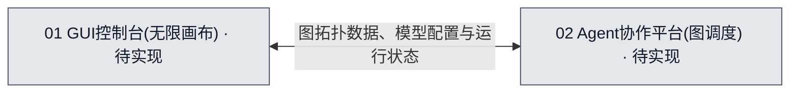

# 00 · 项目整体总览

## 当前进度与直接跳转
无

## 1. 整体流程图
## 流程图可视化

- 图源：[00-整体总览.mmd](./00-整体总览.mmd)。
- 图的用途：目标设计（target）。
- 覆盖范围：GUI平台与Agent协作平台的双向交互；状态表示开发进度。
- 图例：灰色＝待实现。

<!-- diagram-source: ./00-整体总览.mmd -->

## 2. 系统说明
- `01 GUI控制台`：为用户提供无限画布，支持节点（Agent会话和模型配置）的编辑与连线，提供工作流可视化图表及交互面板。
- `02 Agent协作平台`：接收并解析画布图（Graph）结构的拓扑，据此建立连线关联的消息路由逻辑，调度并管理各个独立的CLI Agent。

## 3. 跨系统信息流
- **GUI控制台 到 Agent协作平台**：传递画布工作流的图拓扑数据（Nodes, Edges）、各个Agent节点的模型和运行配置，以及执行触发指令。
- **Agent协作平台 到 GUI控制台**：返回各个Agent节点的执行状态、实时输出日志和结果，渲染至对应的节点界面。

## 4. 需完成任务序列

| 任务编号 | 拆分后的任务目标 | 关联流程图节点／下层开发入口 | 文件文档继续入口 | 前置依赖／阻塞原因 | 验收标准 | 完成状态 |
| --- | --- | --- | --- | --- | --- | --- |
| T-01 | 完成系统整体设计图 | [00-整体总览.mmd](./00-整体总览.mmd)，target | 待定 | 前置依赖：无。 阻塞：无。 | 明确无限画布与后端图调度的架构体系划分 | 待开始 |

## 5. 已执行但已废弃的任务序列

暂无已执行后废弃的任务。

| 任务编号 | 拆分后的任务目标 | 关联流程图节点／下层开发入口 | 文件文档继续入口 | 前置依赖／阻塞原因 | 验收标准 | 完成状态 |
| --- | --- | --- | --- | --- | --- | --- |
