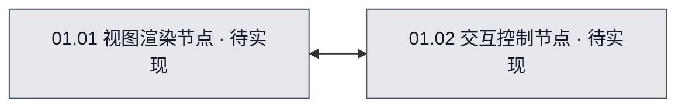

# 01 · GUI控制台

## 当前进度与直接跳转
无

## 1. 系统职责
为用户提供统一界面，展示系统和各个Agent当前的状态信息，并提供对Agent配置与操作指令的交互。

## 2. 系统流程图
## 流程图可视化

- 图源：[01-GUI控制台.mmd](./01-GUI控制台.mmd)。
- 图的用途：目标设计（target）。
- 覆盖范围：GUI系统内部的视图渲染与控制节点划分。
- 图例：灰色＝待实现。

<!-- diagram-source: ./01-GUI控制台.mmd -->

## 3. 节点职责
- **01.01 视图渲染节点**：负责将来自协作平台的信息格式化展示在页面上。
- **01.02 交互控制节点**：负责收集页面用户的交互输入并转换为控制命令。

## 4. 与其他系统的交接
接收来自`02 Agent协作平台`的状态数据，并向其发送控制指令。

## 5. 当前开发或改造方案
暂未确定具体技术栈，需要根据Agent平台选用对应框架。

## 6. 需完成任务序列

| 任务编号 | 拆分后的任务目标 | 关联流程图节点／下层开发入口 | 文件文档继续入口 | 前置依赖／阻塞原因 | 验收标准 | 完成状态 |
| --- | --- | --- | --- | --- | --- | --- |
| T-01 | 完成GUI控制台系统内部设计 | [01-GUI控制台.mmd](./01-GUI控制台.mmd)，target | 待定 | 前置依赖：无。 阻塞：无。 | 确定GUI架构和交互方式 | 待开始 |

## 7. 已执行但已废弃的任务序列

暂无已执行后废弃的任务。

| 任务编号 | 拆分后的任务目标 | 关联流程图节点／下层开发入口 | 文件文档继续入口 | 前置依赖／阻塞原因 | 验收标准 | 完成状态 |
| --- | --- | --- | --- | --- | --- | --- |
