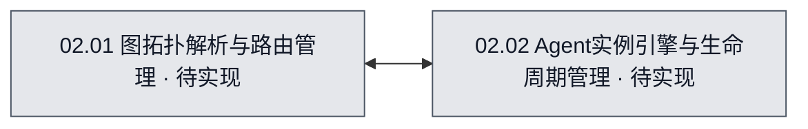

# 02 · Agent协作平台

## 当前进度与直接跳转
无

## 1. 系统职责
作为核心调度平台，接收前端无限画布传来的编排图结构，将“连线”解析为消息路由表，并按需启动和管理各个节点的独立 CLI Agent 会话实例及模型配置。

## 2. 系统流程图
## 流程图可视化

- 图源：[02-Agent协作平台.mmd](./02-Agent协作平台.mmd)。
- 图的用途：目标设计（target）。
- 覆盖范围：协作平台解析图拓扑与管理独立 Agent 实例的逻辑划分。
- 图例：灰色＝待实现。

<!-- diagram-source: ./02-Agent协作平台.mmd -->

## 3. 节点职责
- **02.01 图拓扑解析与路由管理**：解析来自画布的 JSON 等图数据，生成 Agent 节点执行依赖图，并负责根据连线进行运行时消息的分发。
- **02.02 Agent实例引擎与生命周期管理**：为每个被解析出的有效画布节点生成对应的 Agent CLI 子进程/实例，应用选定的模型配置，监控运行状态和销毁过程。

## 4. 与其他系统的交接
接收来自`01 GUI控制台`的节点、连线关系和配置，调度执行后将实例的运行状态返回给 GUI 更新界面。

## 5. 当前开发或改造方案
设计健壮的 DAG/图 解析算法和统一的子进程路由通信协议。

## 6. 需完成任务序列

| 任务编号 | 拆分后的任务目标 | 关联流程图节点／下层开发入口 | 文件文档继续入口 | 前置依赖／阻塞原因 | 验收标准 | 完成状态 |
| --- | --- | --- | --- | --- | --- | --- |
| T-01 | 完成Agent拓扑调度后端设计 | [02-Agent协作平台.mmd](./02-Agent协作平台.mmd)，target | 待定 | 前置依赖：无。 阻塞：无。 | 确定图解析与路由的实现方案及Agent实例管理规范 | 待开始 |

## 7. 已执行但已废弃的任务序列

暂无已执行后废弃的任务。

| 任务编号 | 拆分后的任务目标 | 关联流程图节点／下层开发入口 | 文件文档继续入口 | 前置依赖／阻塞原因 | 验收标准 | 完成状态 |
| --- | --- | --- | --- | --- | --- | --- |
